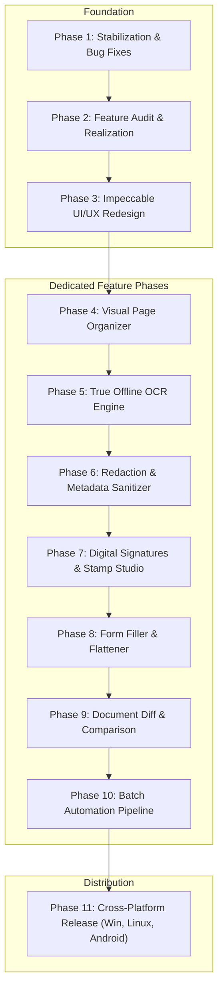
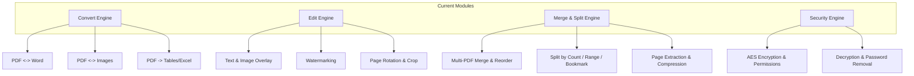
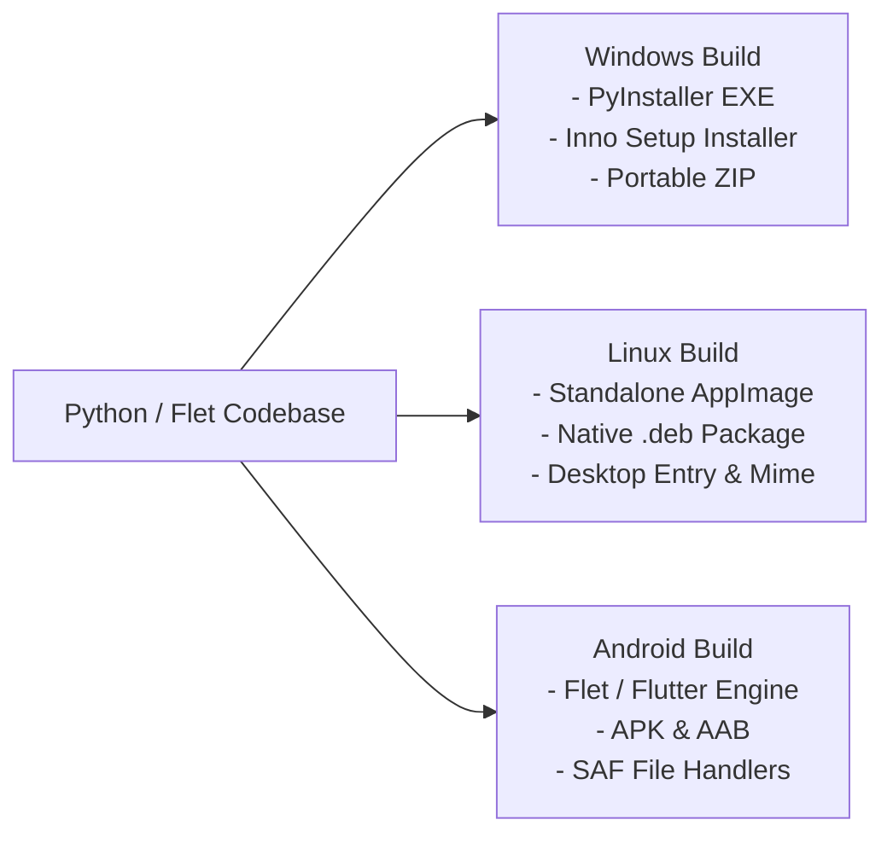
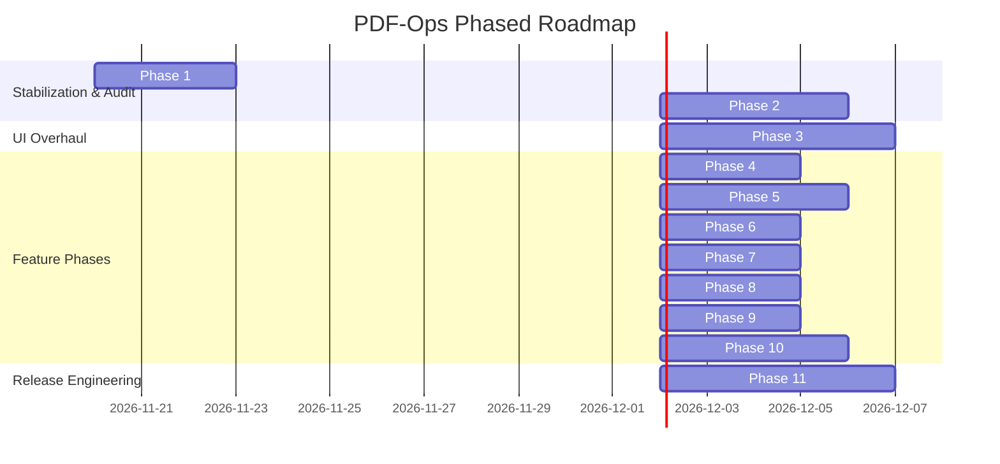

# WAY FORWARD: PDF-Ops Roadmap & Architecture Plan

> **Product**: PDF-Ops  
> **Target Platforms**: Windows (Installer & Portable), Linux (AppImage & Deb), Android (APK)  
> **Design Philosophy**: High-craft utility built with Impeccable principles (Operate Mode: density, clarity, precision, responsiveness)  
> **Status**: Planning & Roadmap Phase (Implementation paused per instructions)

---

## Executive Summary & Vision

**PDF-Ops** is evolving from a single-window prototype into a production-grade, privacy-first, cross-platform PDF manipulation powerhouse. Everything processes locally on the user's device—no third-party cloud uploads, no subscriptions, and zero data leakage.



---

## Phase 1: Stabilization & Core Issue Resolution

Before redesigning or adding new features, the existing codebase must run reliably, eliminating silent failures and architectural disconnects.

### 1.1 Critical Bugs & Immediate Fixes

| Issue | Severity | Root Cause | Fix Strategy |
| :--- | :--- | :--- | :--- |
| **State Disconnect (`client_storage`)** | 🚨 Critical | `main.py` saves file selection to `self.current_file`, but child modules (`convert.py`, `edit.py`, `merge.py`, `security.py`) query `page.client_storage.get("current_file")` which is never set. All operations fail with *"Please select a file first"*. | Introduce a centralized reactive `AppState` or event-driven model. When a file is dropped or picked, propagate it to all active module controllers and update UI state. |
| **Flet 1.x Compatibility Breaks** | ⚠️ High | Installed environment uses `flet 1.1.2`, where color constants, window sizing properties, and event handlers have migrated from earlier `0.10.x` signatures. | Audit all UI calls against Flet 1.x APIs; replace deprecated `ft.colors` / `ft.icons` patterns and update window configuration. |
| **Silent Mock / Stub Implementations** | ⚠️ High | `word_to_pdf`, `pdf_to_excel`, `excel_to_pdf`, `pdf_to_ppt`, `ppt_to_pdf` only call `simulate_progress()` and show placeholder text. | Clearly separate fully functional native features from external-dependency workflows. Replace mock Excel export with native PyMuPDF `find_tables()` extraction. |
| **Preview Temp File Leakage** | 🟡 Medium | `create_pdf_preview()` creates temporary `.png` files via `NamedTemporaryFile(delete=False)` without cleanup. | Implement an in-memory byte buffer (`base64` or memory stream) for preview images, or register automatic cleanup on session change. |
| **Thread-Safety & Progress Race Conditions** | 🟡 Medium | Worker threads call `update_progress()` directly mutating controls across thread boundaries. | Use `page.run_task()` or thread-safe message queues to ensure UI updates execute within Flet's safe event loop. |
| **PyPDF2 / PyMuPDF Deprecation Notices** | 🟡 Medium | `fitz` import issues future deprecation warnings; `PyPDF2` has merged into `pypdf`. | Standardize on `pymupdf` (direct import) and `pypdf` >= 4.0 for standard manipulations. |

### 1.2 Deliverables for Phase 1
- [x] Clean app boot on Linux desktop (`python main.py`) with zero crashes. Verified against Flet 1.1.2 on 2026-11-20.
- [x] Working file handoff: Selected file is immediately recognized by Convert, Edit, Merge, and Security tabs. Verified by the AppState subscriber test on 2026-11-20.
- [x] Clean console output without deprecation warnings or unhandled thread exceptions. Verified with `FutureWarning` promoted to an error and a clean Flet desktop-session startup on 2026-11-20.
- [x] Comprehensive unit tests verifying each backend function isolated from the UI. Verified across 14 unit tests in `tests/test_phase1.py` and `tests/test_phase2.py` on 2026-11-20.

---

## Phase 2: Feature Audit & Functional Realization

A systematic audit of all four existing modules to elevate them from proof-of-concept to robust engines.



### 2.1 Conversion Module Audit
- **PDF to Word**: Validate `pdf2docx` layout fidelity with multi-column text, embedded graphics, and tables.
- **PDF to Images / Images to PDF**: Ensure DPI selection (72, 150, 300 DPI), support for PNG, JPEG, WEBP, and maintaining correct aspect ratio and page geometry.
- **PDF to Excel (Real Implementation)**: Replace the simulation with `pymupdf.find_tables()` to parse tabular bounding boxes directly into `.xlsx` using `openpyxl`.
- **Office Documents to PDF**: Provide real system detection for headless conversion (e.g., LibreOffice CLI fallback `soffice --headless --convert-to pdf`) with a helpful download/guide banner if absent.

### 2.2 Edit & Page Geometry Module
- **Coordinate Precision**: Replace arbitrary pixel offsets with relative normalized coordinates (0.0 to 1.0) so text/watermarks scale correctly across varied page dimensions (Letter, A4, Legal).
- **Watermark Engine**: Support opacity slider (10% to 100%), arbitrary angle, font size, and layered placement (behind or over page contents).
- **Page Transformations**: Fix cumulative rotation (90°, 180°, 270°) and cropping margins ensuring the `MediaBox` and `CropBox` are updated in sync.

### 2.3 Merge, Split & Compress
- **Merge Queue**: Support drag-to-reorder list, page count inspect, and preserve outlines (bookmarks) from merged files.
- **Split Strategies**: Split by fixed page intervals, split by custom range (e.g., `1-3, 5, 8-end`), or split automatically on top-level bookmark chapters.
- **Compression**: Implement stream compression, image downsampling, and font subsetting using PyMuPDF `deflate=True` and garbage-collection modes.

### 2.4 Security & Permissions
- **Encryption**: Modern standard AES-256 encryption using PyMuPDF.
- **Granular Permissions**: Restrict printing, content copying, editing, comments, and form filling with owner password vs. user viewing password.
- **Decryption**: In-memory decryption and validation with feedback on invalid passphrases.

### 2.5 Deliverables for Phase 2
- [x] Standalone, UI-independent `pdf_engine.py` covering conversion, image export, compression, page ranges, geometry, and security.
- [x] Multi-format image export (PNG, JPEG, WEBP) and DPI presets (72, 150, 300) with Pillow fallback.
- [x] Office-to-PDF headless detection and conversion (`soffice` / `libreoffice`).
- [x] Tabular PDF extraction directly to `.xlsx` worksheets via `pymupdf.find_tables()`.
- [x] In-memory, temp-file-free Images-to-PDF conversion.
- [x] Custom range parsing supporting `1-3, 5, 8-end` syntax.
- [x] Bookmark chapter splitting and inspected file metadata (page count + size) in the merge queue.
- [x] Full AES-256 encryption and decryption replacing deprecated/broken PyPDF2 flags.
- [x] 14 automated unit tests in `tests/test_phase2.py` passing with 100% success.

---

## Phase 3: Full UI/UX Redesign with Impeccable (Operate Mode)

*(Implementation on hold until Phases 1 & 2 are finalized and approved.)*

The app will undergo a ground-up UI overhaul guided by the **Impeccable** design framework in **Operate Mode** (task efficiency, high scanability, native affordances, and zero decorative clutter).

```
+---------------------------------------------------------------------------------------+
|  PDF-OPS  [ v1.0 ]              [ Search tools... ]       [ 🌙 / ☀️ ]  [ ⚙️ Settings ]|
+----------------------+------------------------------------------------+---------------+
|  NAVIGATION          |  PRIMARY WORKSPACE                             |  FILE DETAILS |
|  ------------------  |  --------------------------------------------  |  ------------ |
|  [⚡ Quick Actions]   |  +------------------------------------------+  |  annual.pdf   |
|  [📄 Convert]        |  |                                          |  |  Size: 4.2 MB |
|  [✏️ Edit & Stamp]   |  |        DROP PDF OR FOLDER HERE           |  |  Pages: 24    |
|  [🔀 Merge & Split]  |  |           [ Browse Files ]               |  |  Encrypted: No|
|  [🛡️ Security]       |  +------------------------------------------+  |               |
|  [📑 Page Manager]   |                                                |  PAGE PREVIEW |
|  [🔍 OCR & Text]     |  [ Batch Queue: 3 files loaded ]               |  +---------+  |
|  ------------------  |  [⚙️ Operation Parameters & Presets          ] |  | [Page 1]|  |
|  OUTPUT LOCATION     |                                                |  +---------+  |
|  📁 ~/Documents/...  |  [▶ Start Processing]    [Progress: 75%      ] |  | [Page 2]|  |
+----------------------+------------------------------------------------+---------------+
```

### 3.1 Design Principles & System
1. **Surface Mode = Operate**:
   - Every pixel serves the workflow. The user is here to get documents processed swiftly.
   - High information density without visual noise. Generous hit targets, intuitive keyboard shortcuts (`Ctrl+O`, `Ctrl+S`, `Escape`, `Delete`).
2. **Palette & Typography**:
   - **Neutral Slate Architecture**: Deep slate dark mode (`#0F172A`, `#1E293B`) and crisp paper light mode (`#F8FAFC`, `#FFFFFF`).
   - **Semantic Accents**: Vibrant Indigo/Electric Blue for primary actions, Emerald for success/safe states, Amber for non-destructive warnings, Rose for destructive actions.
   - **Typography**: Clean system sans-serif hierarchy (Inter / Roboto / Segoe UI) with tabular numbers for file sizes, page counts, and percentage indicators.
3. **Responsive Dual-Pane Architecture**:
   - **Desktop**: Left navigation rail + central action stage + right contextual inspector/preview canvas.
   - **Mobile / Android**: Bottom navigation bar + modal bottom sheets for operation settings + single-column swipeable cards.
4. **Interactive Page Canvas**:
   - Replace static image previews with an interactive visual thumbnail strip.
   - Hover states show page numbers, rotate icons, and quick-delete actions.
5. **Micro-Interactions**:
   - Drag-over highlight with animated dashed borders.
   - Indeterminate pulse transitioning to determinate progress during batch tasks.
   - Toast notifications with inline "Open Folder" / "View File" action buttons.
6. **Prepare Responsive design scheme**
   - Create and implement important principles that will be needed for Android
   - Make sure the app looks visually appealing and not cluttered on smaller screens like Android phones

---

## Phase 4: Visual Page Organizer (Thumbnail Grid & Manipulation)

Transform static PDF page viewing into an interactive, visual canvas where users can manipulate pages directly.

### 4.1 Objectives & Scope
- Provide a responsive grid of high-fidelity rendered page thumbnails for any loaded document.
- Support fluid visual reordering via drag-and-drop.
- Multi-select page controls: hold `Shift` or `Ctrl` (or tap multiple cards on Android) to batch rotate, delete, or duplicate pages.
- Visual extraction: select any arbitrary pages from the grid and click "Extract as New PDF".
- Insert pages: pick another PDF and visually insert its pages at any position in the thumbnail grid.

### 4.2 Technical Architecture
- **Rendering**: PyMuPDF asynchronous thumbnail generation into base64 / memory images with lazy-loading so 500+ page documents do not freeze memory.
- **State**: A reactive list of page descriptors `[{source_pdf, page_num, rotation_deg, is_deleted}]` that calculates final output on save rather than re-saving on each drag.
- **UI Control**: Custom grid view with drag-and-drop feedback, badge numbers, page orientation indicators, and floating bulk-action toolbar.

### 4.3 Deliverables
- [ ] Responsive thumbnail grid rendering within 500ms for typical 20-page documents.
- [ ] Drag-and-drop page reordering with smooth visual placeholder snapping.
- [ ] Floating action bar for Rotate 90° CW/CCW, Delete, Duplicate, and Extract.
- [ ] Instant export producing bit-perfect rearranged PDF without quality loss.

---

## Phase 5: True Offline OCR & Searchable PDF Engine

Turn scanned paper documents, non-selectable PDFs, and raw image collections into fully searchable, selectable, and indexable PDF documents.

### 5.1 Objectives & Scope
- 100% offline, local OCR processing without sending sensitive document text to any cloud API.
- Support multi-language optical character recognition (English, French, German, Spanish, etc.).
- Generate dual-layer searchable PDFs: high-resolution visible scan on top, perfectly aligned invisible selectable text layer underneath.
- Text extraction tool: extract recognized text directly to clipboard, `.txt`, or formatted Markdown.

### 5.2 Technical Architecture
- **Engine**: Integration with `tesserocr` / `pytesseract` or native PyMuPDF OCR bindings (`fitz.open().get_page_textpage_ocr()`).
- **Pre-Processing Pipeline**: Pillow / OpenCV deskewing, contrast stretching, and noise reduction prior to OCR to maximize recognition accuracy.
- **Progressive OCR Worker**: Multi-threaded page-by-page OCR reporting per-page progress and remaining time estimates.

### 5.3 Deliverables
- [ ] OCR settings panel with language selector, deskew toggle, and DPI quality preset.
- [ ] Searchable PDF output verifiable via Adobe Reader / Evince / Chrome search (`Ctrl+F`).
- [ ] Direct text export tab allowing quick copy of recognized text to clipboard or disk.

---

## Phase 6: Permanent Redaction & Metadata Sanitizer

Provide enterprise-grade privacy protection by permanently removing confidential text and purging hidden tracking metadata.

### 6.1 Objectives & Scope
- **True Redaction**: Permanent removal of underlying text, vector shapes, and bitmap image streams—not merely drawing a black rectangle over visible pixels.
- **Pattern Auto-Redaction**: Search-and-redact presets for sensitive data patterns:
  - Email addresses
  - Phone numbers
  - Social Security / National ID numbers
  - Credit card numbers
- **Metadata Sanitizer**: One-click purge of all document tracking metadata:
  - Author name, creator, producer, software version
  - Creation and modification timestamps
  - Embedded thumbnails, color profiles, and XML metadata packets (XMP)

### 6.2 Technical Architecture
- **Redaction Engine**: PyMuPDF `page.add_redact_annot()` followed by `page.apply_redactions()`. This physically eliminates characters from the PDF font and stream dictionary.
- **Regex Matcher**: Configurable regex engine that scans text coordinates and adds bounding redactions automatically.
- **Metadata Wiper**: Strip document `info` dictionary and reset `doc.set_metadata({})`.

### 6.3 Deliverables
- [ ] Manual redaction selector (draw bounding box over any page region).
- [ ] Regex pattern detector with instant preview list of matched confidential strings.
- [ ] One-click "Sanitize Metadata" toggle with a report of deleted metadata fields.
- [ ] Zero leakage verification: redacted text cannot be copied, searched, or extracted via CLI tools.

---

## Phase 7: Digital Signatures & Stamp Studio

Equip users to quickly sign agreements, add official rubber stamps, and verify document integrity.

### 7.1 Objectives & Scope
- **Signature Studio**:
  - Touch/Mouse drawing pad with variable stroke width.
  - Image signature upload (PNG/JPG with automatic background removal).
  - Type-to-sign with multiple cursive script typography options.
  - Saved signature vault for quick one-click signing in future sessions.
- **Stamp Presets**:
  - Pre-styled professional stamps: `APPROVED`, `CONFIDENTIAL`, `DRAFT`, `FINAL`, `PAID`, `REJECTED`.
  - Dynamic stamp variables: auto-appends current date, time, and operator name.
  - Customizable stamp colors (Classic Red, Navy Blue, Forest Green) and borders.

### 7.2 Technical Architecture
- **Signature Capture**: Flet Canvas control capturing point vectors for smooth quadratic bezier curve rendering.
- **Background Eraser**: PIL thresholding filter to automatically make white paper backgrounds transparent on uploaded signatures.
- **Layer Placement**: Normalized coordinate placement supporting click-to-place and resize handles.

### 7.3 Deliverables
- [ ] Signature drawer with Pen, Clear, and Save options.
- [ ] Stamp generator with live preview and custom text input.
- [ ] Interactive click-to-place overlay on the document preview canvas.
- [ ] Multi-page signing capability (e.g., initial every page, full signature on final page).

---

## Phase 8: Interactive Form Filler & Flattener

Inspect, fill, and finalize PDF forms (`AcroForms`) directly inside PDF-Ops.

### 8.1 Objectives & Scope
- Automatically parse all interactive form fields (text boxes, checkboxes, radio buttons, dropdowns).
- Present fields in a clean, accessible inspector sidebar with keyboard tab order navigation.
- Fill form values and save as an editable PDF.
- **Flatten Form**: Convert all filled form data into static page vector graphics and text, preventing further modification.

### 8.2 Technical Architecture
- **Form Parser**: PyMuPDF `page.widgets()` extracting field names, types, rect coordinates, and current values.
- **Form Builder**: Dynamically generated Flet input controls bound to field keys.
- **Flattener**: PyMuPDF widget baking (`widget.update()` or page raster/vector flattening) into immutable PDF streams.

### 8.3 Deliverables
- [ ] Form detection badge displaying count of fillable fields upon document load.
- [ ] Auto-generated form sidebar mirroring document form structure.
- [ ] "Save as Editable Form" and "Save & Flatten (Read-Only)" export actions.

---

## Phase 9: Document Diff & Visual Comparison

Compare two PDF revisions side by side to instantly pinpoint changes.

### 9.1 Objectives & Scope
- Side-by-side or split-screen comparison of two PDF files (e.g., Version 1 vs. Version 2 of a contract).
- Synchronized dual-pane scrolling and zoom.
- Visual Pixel Diff: Highlight modified areas in red/green overlays.
- Textual Diff: Highlight added, deleted, or altered text with a change ledger.

### 9.2 Technical Architecture
- **Visual Diff Engine**: Render matching pages via PyMuPDF at matching DPI, compute pixel delta using PIL / NumPy difference masks, and overlay colored heatmaps.
- **Text Diff Engine**: Extract text blocks with PyMuPDF, run Python `difflib.SequenceMatcher`, and highlight bounding boxes corresponding to altered tokens.
- **Viewport**: Dual scrollable Flet columns with synchronized scroll offset event listeners.

### 9.3 Deliverables
- [ ] Document comparison launcher with File A and File B selectors.
- [ ] Visual diff mode showing overlay heatmap of graphic/layout adjustments.
- [ ] Text diff mode with sidebar summary of changes ("12 additions, 3 deletions").
- [ ] Exportable difference report PDF.

---

## Phase 10: Batch Automation & Multi-File Pipeline

Scale up PDF-Ops from one-at-a-time document editing to processing hundreds of files simultaneously.

### 10.1 Objectives & Scope
- Multi-file and entire folder drag-and-drop queue.
- Workflow Recipe Builder: Chain operations together into a single automated pipeline:
  - *Example Recipe*: `[Compress Medium] -> [Add Confidential Watermark] -> [Encrypt with Password] -> [Sanitize Metadata]`.
- Multi-core parallel processing using Python `concurrent.futures`.
- Output folder routing with customizable naming conventions (e.g., `{original_name}_processed_{date}`).

### 10.2 Technical Architecture
- **Pipeline Runner**: Functional pipeline pattern passing file paths and temporary byte streams through sequential processing hooks.
- **Process Pool**: `ProcessPoolExecutor` utilizing all available CPU cores without blocking the Flet GUI.
- **Status Dashboard**: Table listing all queued files, individual status chips (Pending, Processing, Done, Failed), and total batch ETA.

### 10.3 Deliverables
- [ ] Batch queue table with file size, page count, and status badges.
- [ ] Preset dropdown (e.g., "Prepare for Email", "Archive Prep", "Secure Distribution") and custom recipe builder.
- [ ] Multi-threaded execution bar displaying overall batch progress.
- [ ] Detailed post-batch summary log with "Open Output Directory" button.

---

## Phase 11: Cross-Platform Packaging & Release Pipeline

Targeting **Windows**, **Linux**, and **Android** from a single unified codebase with automated CI/CD.



### 11.1 Platform Specifics & Distribution Matrix

| Platform | Output Artifacts | Packaging Engine | Key System Considerations |
| :--- | :--- | :--- | :--- |
| **Windows** | `PDF-Ops-x64Setup.exe`<br/>`PDF-Ops-Portable.zip` | PyInstaller + Inno Setup | • Update existing `.iss` script to remove hardcoded user paths (`C:\Users\Administrator\...` -> dynamic relative paths).<br/>• File association for `.pdf` in Windows Registry.<br/>• Embed app icon into executable. |
| **Linux** | `PDF-Ops-x86_64.AppImage`<br/>`pdf-ops_amd64.deb` | `python-appimage` or PyInstaller + AppImageTool | • Bundle poppler shared libraries or use PyMuPDF standalone wheels.<br/>• Desktop menu entry (`pdf-ops.desktop`) with high-res PNG icon.<br/>• Mime-type integration (`application/pdf`). |
| **Android** | `pdf-ops-arm64-v8a.apk`<br/>`pdf-ops.aab` | `flet build apk` (Flutter / Serious Python) | • Android Storage Access Framework (SAF) permissions for document access.<br/>• Screen touch responsiveness & virtual keyboard handling.<br/>• Compile wheels for `arm64-v8a` target (PyMuPDF has official Android wheels via Termux or pure-python fallback `pypdf`/`pdfplumber`). |

### 11.2 CI/CD Automation (GitHub Actions)

A unified `.github/workflows/release.yml` triggering on git tags (`v*.*.*`):
1. **Windows Job**: Builds on `windows-latest`, compiles binary with PyInstaller, runs Inno Setup compiler (`ISCC.exe`), uploads `.exe` installer.
2. **Linux Job**: Builds on `ubuntu-latest`, packages standalone AppImage and `.deb`, generates sha256 checksums.
3. **Android Job**: Runs `flet build apk` inside Ubuntu container with Android SDK & Flutter installed, signs APK with release keystore.
4. **GitHub Release**: Publishes all artifacts automatically with release notes and checksums.

---

## Master Roadmap Timeline



---

## Action Items: What to Start First

When ready to proceed, execution will follow this order:
1. **Begin Phase 1 (Milestone 1.1)**: Connect central file state between [`main.py`](main.py) and module controllers so file selection immediately works.
2. **Begin Phase 1 (Milestone 1.2)**: Update Flet 1.x deprecated control properties and verify live hot-reload on desktop.
3. **Audit Results Review**: Present the Phase 2 audit results to the user before commencing Phase 3 design work.
